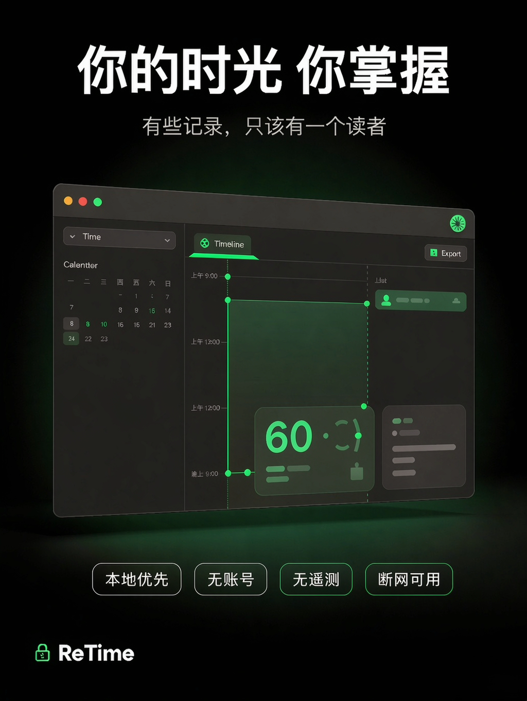

# ReTime

<p align="center">
  
</p>

**你的时光 你掌握**

有些记录，只该有一个读者。

macOS 本地优先的个人时间记录应用：事项、日程、备忘录、日记、记账、生理期、倒数日，一个地方记全。
数据全部存在你自己的 Mac 上，**无账号、无遥测、不联网也能用完整功能**。

---

## 看看它长什么样

<p align="center">
  <a href="https://raw.githubusercontent.com/windcool18-maker/ReTime-releases/main/assets/ReTime-freeze-time-v6-final.mp4" title="下载原片（带声音）">
    
  </a>
</p>

<p align="center">
  <sub>▲ 宣传短片《把时间留住》· 15 秒循环（此处无声）· <a href="https://raw.githubusercontent.com/windcool18-maker/ReTime-releases/main/assets/ReTime-freeze-time-v6-final.mp4">下载原片 mp4（4.5 MB，带声音）</a></sub>
</p>

<p align="center">
  
</p>

<p align="center">
  <sub>▲ 时间轴界面：一件事占多长时间，一眼看得见</sub>
</p>

---

## 下载

👉 **[下载最新版](https://github.com/windcool18-maker/ReTime-releases/releases/latest)**

当前版本 **1.6.2**（2026-11-05）

| | |
|---|---|
| 系统 | **macOS 14（Sonoma）或更高** |
| 芯片 | **Apple Silicon M1 及以后全系**（M1 / M1 Pro·Max·Ultra / M2 全系 / M3 / M4 / M5），Mac 笔记本与台式机均可 |
| 体积 | DMG `5.0 MB` / 安装后 `18 MB` |

> **版本沿革**：1.6.1（2026-11-05）首发时曾把最低系统误设成 macOS 27，导致 macOS 14–26 全部装不上（M1 / M2 早期机型最高只能升到 26），当日已把编译目标降为 14.0 并两次同名重打包。**1.6.2（2026-11-05）**把品牌文案升级为主标「你的时光 你掌握」+ 副标「有些记录，只该有一个读者」，**功能与数据结构未变**。手上若是 1.6.1 或更早的包，直接下载 1.6.2 覆盖安装即可，数据在用户目录不受影响。 **2026-11-05 晚间补记**：因品牌标识统一，1.6.2 DMG 已**同名重打包** （新 SHA-256 见下方），此前下载过的请重新下载；1.6.0 / 1.6.1 / 1.5.2 三个历史包已下架。
>
> **关于系统要求**：14.0 是硬下限 —— 数据层用的 SwiftData 从 macOS 14 才引入。本构建用 macOS 27 SDK 编译，但 SDK 只决定「能用哪些 API」，编译 `-target` 才决定「能装在哪代系统」，两者不必相同。产物的 `LC_BUILD_VERSION minos` 与 Info.plist 的 `LSMinimumSystemVersion` 现均为 **14.0**，页面与产物一致。当前是 arm64 通用二进制，**不含 Intel 版本**。

## 安装（三步，第二步和网上教程不一样，请照这个做）

1. 下载 `ReTime-1.6.2.dmg`，双击打开，把 **ReTime** 拖进左边的「应用程序」
2. **在「应用程序」里双击 ReTime** → 会弹一个「无法打开」的框，点「完成」关掉
3. 打开 **系统设置 → 隐私与安全性**，向下滚动到底部，会看到「已阻止"ReTime"以保护Mac。」→ 点旁边的 **「仍要打开」** → 输入密码或触控 ID。系统放行后会直接把它打开

之后就可以正常双击了，不用再走一遍。

> ⚠️ **「右键 → 打开」只在 macOS 14 上还有效**；Apple 在 macOS 15 及以后删掉了这条绕过路径，照旧教程做只会一直卡住。上面三步法在 14 / 15 / 26 / 27 上都一样能用，所以统一按三步写。

> **为什么首启会被拦一次**
> 因为当前版本没有做 Apple 公证 —— 公证需要每年 99 美元的开发者账号，这个项目还没到那一步。
> App 本身没有被篡改，你可以自己验证签名：
> ```
> codesign -dv /Applications/ReTime.app
> ```
> 会用终端的话，也可以拖进「应用程序」后一行跳过前面的步骤：
> ```
> xattr -dr com.apple.quarantine /Applications/ReTime.app
> ```
> ⛔ **请不要为了装上它去关闭「系统设置 → 隐私与安全性」里的全局 Gatekeeper**，那会让整台电脑失去保护。

## 校验下载完整性

```bash
shasum -a 256 -c ReTime-1.6.2.dmg.sha256
```

1.6.2 的期望值：

```
6db16e58ca162a77d67ee1b454d0153ddf113c64a5e65e0d92f78788f36aac91
```

## 第一次打开是空库

想先看看界面长什么样：**设置（⌘,）→ 示例数据 → 载入示例数据**。

会填好记账、周期记账、生理期、事项、倒数日、备忘录、速记、日记共八类样例，全部带 `[样例]` 标记，一眼能分辨，也可以随时一键清除。已经有你自己记录的模块不会被改动。

## 不会用的时候

菜单栏 **「帮助 → ReTime 使用说明」**、设置里的 **「使用说明」标签页**，或按 **⌘?**，看到的都是同一份内容。按「我想做什么」组织，七条：要不要先激活（90 天完整试用、期满功能照常可用、数据留本机）、第一次打开看什么、记一笔账、写一篇日记、事项 / 清单 / 日程到底该记哪、数据在哪怎么备份、换一台 Mac 怎么搬。

说明是一个独立窗口，可以留在旁边照着做，不会挡住主界面；「设置 → 使用说明」标签页里也有同一份内容。

设置分七个标签页：**通用 / iCloud / 备份 / 数据 / 安全 / 关于 / 使用说明**。备份页按「备份通道 → 备份策略 → 备份恢复」排，先选好写到哪，再谈什么时候备。

想确认有没有新版本：**设置 → 关于 → 查看是否有新版**。点它才会联网查询一次版本号，不下载、不安装，启动不联网。

## 能做什么

事项（四视图 + 重复规则）· 日程（日/周/月/列表 + 时间轴，可只读叠加系统日历）· 备忘录（富文本 + 自建分类）· 日记（富文本 + 心情 + 天气）· 规划（今天/本周/本月）· 倒数日与纪念日 · 记账（分类占比 + 预算提醒 + 周期记账）· 生理期 · 速记 / 取字 / 剪贴板历史

另有：全局搜索 ⌘F、回收站（保留 30 天）、整库备份与恢复、CSV 导出导入、模块密码锁、界面缩放与文字大小两档独立调节（最大 200%）。

## 三条承诺，都可以自己验证

**1. 不联网也能用。** 拔掉网线用一周，功能一个都不会少。断网时唯一失效的是你自己配置的 WebDAV 同步。

**2. 没有任何遥测。** 没有统计 SDK、没有崩溃上报、没有埋点、没有账号系统。可以用 Little Snitch 之类的工具盯着它。

**3. 数据就是一个文件夹。** `~/Library/Application Support/default.store`（连同 `-wal` / `-shm`）。这个文件夹里是 **3 个文件**：`default.store`、`default.store-wal`、`default.store-shm`，三者合起来才是完整数据；只拷主库会丢掉还留在 `-wal` 里的最近记录——它常常比主库本身还大。退出 ReTime 后整个文件夹复制走就能带走，删掉就是清空，不藏在沙盒深处，不需要登录才能导出；也可以在「设置 → 备份 → 备份恢复 → 导出备份包…」拿到一个自洽、带校验的备份包文件夹。

> 关于「加密」，说准确一点：**数据库是明文 SQLite** —— 这样你才能用任何工具打开自己的数据。模块密码锁做的是**界面门禁**（密码经 PBKDF2-HMAC-SHA256 / 12 万轮哈希后存本机），不是磁盘加密。需要防盗请开启 macOS 自带的 FileVault。

## 试用与购买

首次打开起 **90 天完整试用**。到期后**不锁任何功能** —— 数据都在本机、功能照常可用，只是每天会出现一次购买提示，点掉即可。

正式版 **¥68，含 365 天更新**；更新期过后，当前版本继续可用。授权码离线校验，不需要账号、不联网激活。购买与咨询：`windcool99@agent.qq.com`（App 内到期提示里的「联系作者购买」会直接填好主题）。

## 已知限制（如实列出）

- **不做自动更新，但可以手动查。** ad-hoc 签名无法校验更新包来源，接一个无法验证的更新通道等于开后门。所以 App 只提供一个「查看是否有新版」按钮：**你点它才联网**读一次版本号，不下载、不安装、启动不联网。升级方式仍是下载新版 `ReTime.app` 覆盖旧版
- **不使用 iCloud 容器。** 云备份只有两条路：你自己配的 WebDAV，或把「自定义文件夹」指向你网盘的本地同步目录；也可以把备份写进 iCloud 云盘的普通文件夹，由系统客户端上传
- **没有自动双向同步。** 跨设备可以走「合并备份（不动本地数据）…」做**只增不减**的手动合并（不覆盖、不删除、不传播删除）；「从备份恢复…」则是**整库覆盖**，会盖掉当前库，操作前请确认。两台 Mac 不要同时写同一个库
- **剪贴板历史不进导出、不进备份**
- **安全锁不随备份迁移**（恢复后需在本机重新设置）
- 界面目前只有简体中文

## 反馈

发现 bug 或有建议，两种方式都行，写明：系统版本、ReTime 版本、复现步骤。

- 在本仓库 [开 issue](https://github.com/windcool18-maker/ReTime-releases/issues)
- 发邮件到 `windcool99@agent.qq.com`（不方便注册 GitHub 的话走这条）

个人项目，回复可能不及时，但每一条都会看。

## 关于源码

**这个产品是闭源的。** 本仓库只发布二进制与校验值，不含源码。未经许可不得再分发、修改或用于商业用途；`ReTime` 名称与图标保留所有权利。

---

*ReTime is a closed-source, local-first personal time tracker for macOS. No account, no telemetry, works fully offline. Requires macOS 14 Sonoma or later on Apple Silicon (M1 or later; Mac laptops and desktops; no Intel build). Interface is Simplified Chinese only for now.*

*⚠️ The 1.6.1 DMG was re-uploaded twice on 2026-11-05 (first to fix the minimum OS requirement 27 → 14, then to align the in-app Help text with the actual UI) — same filename, new SHA-256 each time. If you downloaded it earlier that day, please download again and verify.*

*⚠️ The 1.6.2 DMG was rebuilt on 2026-11-05 to unify the app identifier (`com.retime.app`). Same filename, new SHA-256 shown above. If you downloaded it before, please download again and verify. Older 1.6.0 / 1.6.1 / 1.5.2 builds have been retired.*

*Data lives in one folder (`~/Library/Application Support/default.store` plus `-wal` / `-shm`) — three files in total, and only together are they complete; copying just the main store drops whatever is still in the write-ahead log. There is no automatic two-way sync, restore replaces the whole database, and a manual additive-only merge is available. Closed source, 90-day full trial; after that every feature keeps working and a once-a-day purchase reminder appears. Full licence is ¥68 including 365 days of updates, activated offline with a licence key.*
